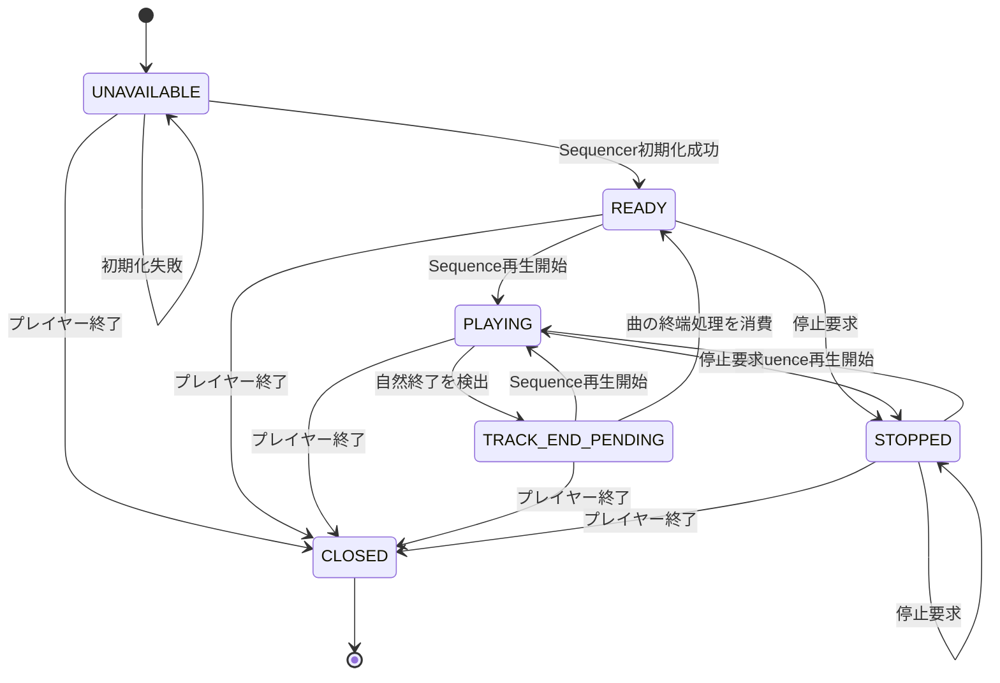

# AutoMerody_MidiPlayer

30個の素材MIDIからモチーフを選び、音符データを加工・結合してメモリ上にSequenceを生成し、そのまま再生するProcessing（Javaモード）のスケッチです。生成MIDIはディスクに保存しません。以前の`auto_melody_player`は参照用として別ディレクトリに残してあり、このディレクトリを更新対象とします。

## 構成

アプリ本体と、生成・再生の2つの処理モジュールで構成されています。このディレクトリ内の`.pde`ファイルはProcessing上で1つのスケッチとしてコンパイルされます。MIDIファイルの入出力はアプリ本体が行い、モジュール間では読み込み済みのSequenceや生成結果を受け渡します。

```text
AutoMerody_MidiPlayer/
|-- AutoMerody_MidiPlayer.pde   画面、MIDI入出力、再生キュー
|-- AutoMelody.pde               素材選択、Sequence加工、生成
`-- MidiPlayer.pde               Sequencer再生、曲間ブリッジ
```

```text
アプリ本体: 素材MIDI 30個を読み込み、名前とSequenceのテーブルにする
	|
	v
生成モジュール: Sequenceテーブルからモチーフ選択 -> 音符加工 -> A-A-B-C-B構成に結合
		-> コード・ドラムトラックを追加 -> 生成Sequenceを返す
	|
	v
アプリ本体: Sequenceをキューへ登録（ディスク保存なし）
	|
	v
再生モジュール: Sequenceを受け取り -> Java MIDI Sequencer -> OSのMIDI音源
	^
	|
アプリ本体: キー入力、再生キュー、状態表示、次の曲の自動再生
```

### アプリ本体: `AutoMerody_MidiPlayer.pde`

- Processingの画面、素材MIDIの入力、再生キュー、状態表示を管理します。
- 起動時に素材MIDIを読み込み、ファイル名をキーにした`HashMap<String, Sequence>`を生成モジュールへ渡します。
- 生成モジュールから受け取ったSequenceを保存せず、キューに登録します。
- `S`/`T`キーを受け付け、生成モジュールと再生モジュールを呼び出します。
- 停止するまで、曲の生成と再生を続けます。

### 生成モジュール: `AutoMelody.pde`

- アプリ本体から、素材ファイル名と読み込み済みSequenceのテーブルを受け取ります。ファイルシステムにはアクセスしません。
- 1セットごとにA、B、サビのモチーフを選び、A-A-B-C-Bの順に並べます。
- メロディーの音程、ベロシティ、長さ、スウィングなどを加工し、音符を一部省略する場合もあります。その後、コードとドラムのMIDIトラックを追加します。
- ムード、セクション別コード進行、和音品質、拍子別リズムもこのモジュールで決めます。
- 生成Sequenceと曲の情報をアプリ本体へ返します。生成側ではファイル操作を行いません。

素材フォルダーには、`A01_*.mid`から`A10_*.mid`、`B01_*.mid`から`B10_*.mid`、`C01_*.mid`から`C10_*.mid`までの個別ファイルが必要です。`melody_bank_all.mid`などの結合済みファイルは、これらの素材ファイルの代わりにはなりません。

## 生成アルゴリズム

### 曲の構成と素材選択

| 項目 | 処理 |
|---|---|
| 素材候補 | A、B、サビ各10個から、セクションごとに候補を選びます。 |
| 1セットの構成 | 選んだA、B、サビを`A-A-B-サビ-B`の順に並べます。1セットは5フレーズです。 |
| 重複回避 | 同じセット内でA/B/サビの候補を重ねず、直前のセットと同じA候補番号が続かないようにします。 |
| フレーズ長 | 拍子に合わせた2小節です。 |
| セクション接続 | 切替点で前のフレーズ末尾と次のフレーズ先頭を短く重ね、ベロシティを前側0.72倍、次側0.58倍にします。 |

### ムード

| ムード | 和音への主な反映 |
|---|---|
| `balanced` | 基本進行。度数に応じてメジャー/マイナー/ディミニッシュを選択 |
| `sad` | ムード別進行を使い、特定の度数をマイナー化 |
| `powerful` | 低音を含む広いボイシングと強めのベロシティ |
| `bitter` | `major6`と`minor6`を使い分ける |
| `okinawa` | 3度を避け、`sus2`/`sus4`を中心にする |
| `open` | `major6`/`sus4`を使う |
| `city` | `add9`/`minor6`を使う |
| `mystic` | `sus4`/`sus2`を使い分ける |
| `gentle` | `major6`/`minor6`を使う |

曲ごとにムードを選び直し、直前と同じムードはできるだけ避けます。

### コード生成アルゴリズム

| 段階 | 処理 |
|---|---|
| 進行選択 | A/B/サビごとの基本進行とムード別進行から、セクションごとの進行順を選びます。 |
| コード選択 | メロディーの音高クラスをスロットごとに調べ、進行上の候補コードに含まれない場合は、メロディー音を含む近いコード度数を優先します。 |
| 和音品質 | 度数・セクション・拍位置・ムードから、メジャー、マイナー、`add9`、`sus4`、`major6`などを決めます。 |
| ボイシング | 和音品質に合わせて構成音を作り、4パターンの音域/配置変化を順番に加えます。 |
| ベロシティ | ムードごとに和音内の各音のベロシティを設定します。 |

### 拍子とBPM

| 項目 | 設定・処理 |
|---|---|
| 拍子候補 | 2/4、3/4、4/4、6/8、12/8、5/4、7/8、9/8 |
| BPM候補 | 80〜145 BPMの候補値 |
| 小節/フレーズ | 拍子に応じて1小節のスロット数を定め、フレーズ長は2小節にします。 |
| 曲ごとの選択 | 直前の設定を維持する場合と、候補リスト上で1段階変更する場合があります。 |
| 曲終わりの自動変更 | 50%で拍子/BPMを維持。変更する場合はBPMが70%、拍子が30%の確率で選ばれます。 |

### メロディーの加工

曲ごとに次の加工値をランダムに決めます。ムードによってベロシティ、ノート長、スウィング、省略率の範囲が変わります。

| 加工 | 基本設定 | ムード別の例 |
|---|---:|---|
| 移調 | -2〜+2半音 | 全ムード共通 |
| ベロシティ倍率 | 1.08〜1.28 | powerful: 1.18〜1.40、gentle: 0.96〜1.18 |
| ノート長倍率 | 0.95〜1.10 | sad: 0.88〜1.04、powerful: 0.98〜1.18 |
| スウィング | 0、0、6、12、18、24、-12 tickから選択 | powerful/city/mystic: 12、gentle: 0、sad: 6 tick |
| 弱拍のノート省略率 | 0〜5% | sad: 4〜10%、gentle: 2〜8% |

移調後の音域はMIDIノート36〜96に制限します。ベロシティは元のノートオン値に倍率を掛け、1〜127に収めます。ノート長はスウィング後の長さに倍率を掛け、最低24 tick、フレーズ末尾までに制限します。省略対象はコード境界の強拍を避け、ノートオンごとに確率判定します。移調後の音は、その拍のコード音または音階音に合わせて補正します。

### コードとドラムのトラック生成

完成Sequenceにはメロディー・コード・ドラムの3トラックを作ります。コードはチャンネル1、ドラムはチャンネル9に配置します。

| パート | 生成方法 |
|---|---|
| メロディー | 素材の音符を加工し、A-A-B-サビ-B順に連結 |
| コード | 240 tickごとのスロットで進行・メロディー音・ムードから和音を作り、次のスロット直前にノートオフ |
| ドラム | 拍子ごとのキック（36）、スネア（38）、ハイハット（42）。サビではフィル（46）を追加 |
| メタデータ | 曲ごとに選んだBPMと拍子をSequenceへ設定 |

生成したSequenceはアプリ本体へ返し、保存せずに再生します。

### 関数とデータの配置

| 項目 | 主な関数 | 主なデータ |
|---|---|---|
| 曲構成/素材選択 | `buildRandomSequence()`、`buildRhythmBaseSequence()` | `aMotifs`、`bMotifs`、`cMotifs`、`lastRandomBaseIndex` |
| ムード | `pickNextDistinctSongMood()` | `chordMood`、`randomChordMoods`、`lastGeneratedChordMood` |
| コード進行/和音 | `chooseProgressionProfileForSong()`、`pickChordDegree()`、`qualityForDegree()`、`buildChordNotesForExport()` | `progressionA/B/C_*`、`progressionOrdersA/B/C`、`currentProgVarA/B/C` |
| 拍子/BPM | `pickNextDistinctSongMeterIndex()`、`pickNextDistinctSongBpmIndex()`、`addGeneratedTempoAndTimeSignature()` | `meterOptions`、`bpmOptions`、`autoShiftKeepProbability` |
| メロディー加工 | `randomMelodyTransform()`、`copySequenceIntoTrackTransformed()`、`constrainPitchToHarmony()` | `MelodyTransform` |
| コード/ドラムトラック | `addArrangementTracks()`、`isKickSlot()`、`isSnareSlot()`、`isHatSlot()` | `SectionSpan`、`chordSlotTicks`、拍子設定 |

### 再生モジュール: `MidiPlayer.pde`

- Java MIDI Sequencerの初期化、テンポ設定、アプリ本体から渡されたSequenceの再生を担当します。ファイルの再読込はしません。
- 再生状態と単曲/連続の再生モードは`MidiPlayerState`にまとめ、自然終了を一度検出して次曲のキュー処理へ通知します。
- 直前の曲がある場合は、音符単位のブリッジを加えて曲をつなぎます。

#### 再生状態の遷移



`SINGLE`/`CONTINUOUS`は再生状態とは別の再生モードです。自然終了を検出すると状態は`TRACK_END_PENDING`（曲の終端処理待ち）になり、アプリ本体が通知を消費します。連続モードなら、その後に次の曲をキューから開始します。

このスケッチが加工するのは録音済みの音声ではなく、MIDIイベントです。生成されたMIDIはPCのMIDI音源で音声化されます。利用できる音色はOSやMIDI音源によって異なります。

## 起動と操作

1. 素材MIDIへの相対パスが解決できるよう、リポジトリ内のフォルダー構成を保ちます。
2. ProcessingのJavaモードで`AutoMerody_MidiPlayer.pde`を開きます。
3. スケッチを実行します。素材MIDIと出力先の実際のパスはProcessingのコンソールで確認できます。
4. `S`キーを押すと曲を生成して再生します。再生中に次の曲をキューへ追加します。
5. `T`キーを押すと再生を停止し、キューを消去します。

素材MIDIは起動時に読み込みます。生成したSequenceはメモリ上でキューと再生処理に使い、ファイルには保存しません。

## 再生せずに生成する

スケッチの起動前に環境変数`MIDI_BATCH10_ON_START=1`を設定すると、A-A-B-C-B構成を10セット含むSequenceをメモリ上で1つ生成し、成功数を表示して終了します。ファイルは作成しません。

## ライセンス

このソフトウェアはMIT Licenseのもとで公開します。詳細は[LICENSE](LICENSE)を参照してください。
